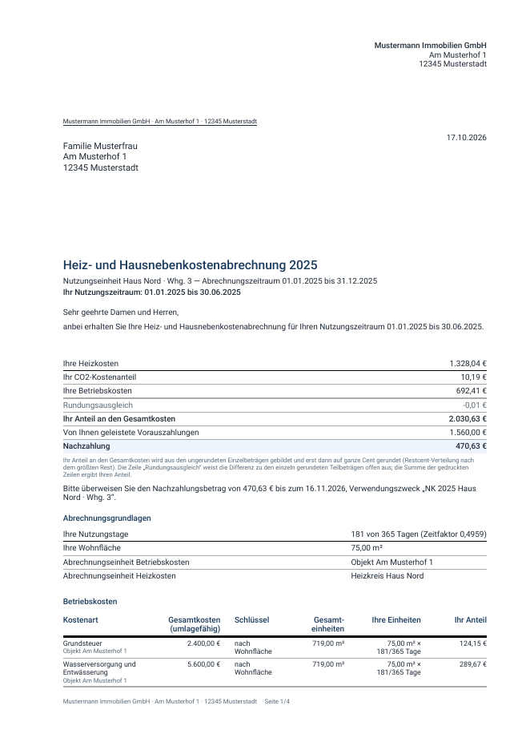
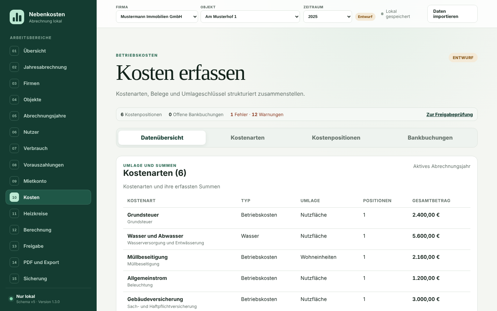
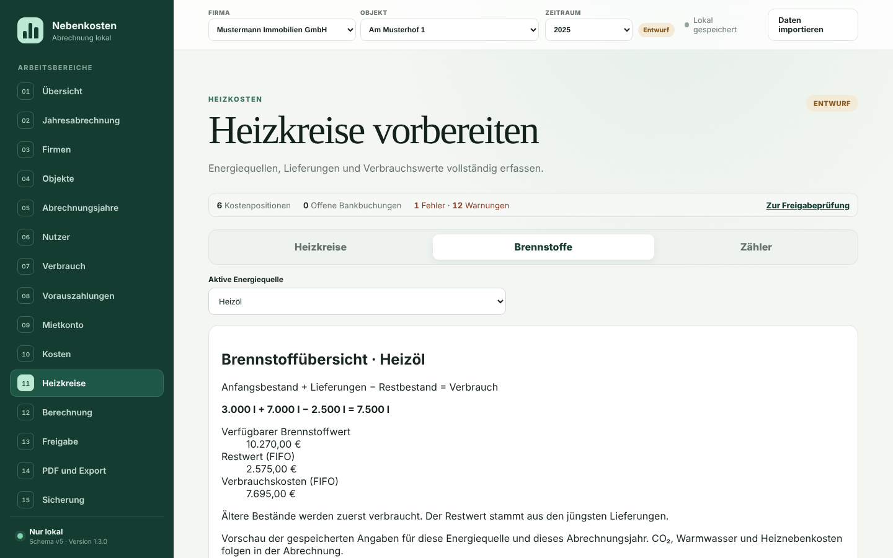
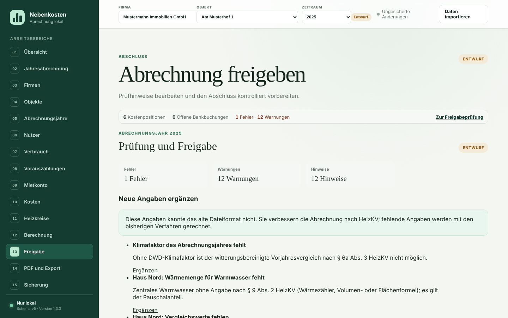

# So sieht die App aus – Rundgang und Musterabrechnungen

Alle Bilder und PDFs auf dieser Seite stammen aus dem **fiktiven
Beispielobjekt** ([`docs/beispiel/`](../beispiel/README.md)): zwei Häuser,
zwölf Wohnungen, Heizöl und Wärmepumpe, ein Nutzerwechsel, Leerstand und ein
Eigentümerwechsel zum 1. April 2025. Namen wie „Erika Mustermann“ und die
Anschrift „Am Musterhof 1“ sind erfunden.

Selbst ausprobieren: [App öffnen](https://kalkprofijanek.github.io/nebenkosten-app/)
→ **Daten importieren** → `beispielobjekt.json`. Die Daten bleiben im eigenen
Browser.

## Musterabrechnungen 2025 (PDF)

So erhält ein Mieter seine Abrechnung – unverändert aus der App erzeugt:

| Datei                                                                                                      | Was der Fall zeigt                                                                                    |
| ---------------------------------------------------------------------------------------------------------- | ----------------------------------------------------------------------------------------------------- |
| [Einzelabrechnung Haus Nord, Whg. 1](musterabrechnung-2025/einzelabrechnung-nord-whg1-oelheizung.pdf)      | Ganzjährige Nutzung, Ölheizung mit Brennstoffkonto (FIFO), 70/30-Verteilung, CO₂-Aufteilung, Guthaben |
| [Einzelabrechnung Haus Nord, Whg. 3 – Auszug](musterabrechnung-2025/einzelabrechnung-nord-whg3-auszug.pdf) | Nutzerwechsel zum 30.06.: Zeitanteil 181/365 Tage, Nachzahlung mit Zahlungsfrist                      |
| [Einzelabrechnung Haus Nord, Whg. 3 – Einzug](musterabrechnung-2025/einzelabrechnung-nord-whg3-einzug.pdf) | Nachmieter ab 01.07., gleiche Wohnung, eigener Zeitraum                                               |
| [Einzelabrechnung Haus Süd, Whg. 1](musterabrechnung-2025/einzelabrechnung-sued-whg1-waermepumpe.pdf)      | Wärmepumpe: keine CO₂-Kosten nach BEHG, Guthaben mit Auszahlungstext                                  |
| [Gesamtabrechnung für Mieter](musterabrechnung-2025/gesamtabrechnung-mieter.pdf)                           | Fassung zur Einsicht für Mieter                                                                       |
| [Gesamtabrechnung intern](musterabrechnung-2025/gesamtabrechnung-intern.pdf)                               | Kontrollfassung für den Vermieter mit Kontrollsumme (muss 0,00 € sein)                                |



**Lesehinweis:** Das Beispiel ist bewusst nicht „perfekt“. Die Prüfung meldet
unter anderem fehlende Vergleichswerte nach § 6a HeizKV, einen pauschalen
Warmwasseranteil statt gemessener Wärmemenge (§ 9 Abs. 2 HeizKV) und
Nutzerwechsel ohne Zwischenablesung (§ 9b HeizKV). Genau diese Hinweise
zeigen, welche Angaben eine echte Abrechnung zusätzlich braucht – siehe
[Rundgang, Schritt 7](#7-freigabe-prüfhinweise-abarbeiten).

## Rundgang in sieben Bildern

### 1. Übersicht


- Oben links **Firma, Objekt, Zeitraum** wählen; alle Seiten beziehen sich
  darauf.
- Die Leiste unter der Überschrift zeigt jederzeit Fehler und Warnungen;
  **Zur Freigabeprüfung** springt zur Liste.
- **Mit KI arbeiten** kopiert einen fertigen Arbeitsauftrag für einen
  KI-Assistenten ([KI-Anleitung](../KI-ANLEITUNG.md)).
- „Lokal gespeichert“ oben rechts bestätigt, dass jede Änderung im Browser
  gesichert ist – eine **Sicherungsdatei** ersetzt das nicht.

### 2. Import prüfen


Vor jeder Übernahme zeigt die App, was die Datei enthält. Erst **Geprüften
Import übernehmen** ersetzt den Arbeitsstand; vorher wird ein
Wiederherstellungspunkt angelegt. Unterstützt: Sicherungen dieser App und
`nk-daten.json` der Alt-App.

### 3. Jahresabrechnung – Belegung prüfen


Der Ablauf **Jahresabrechnung** führt durch acht Schritte. Im Schritt
„Belegung und Vorauszahlungen“ steht jede Wohnung mit allen Nutzungszeiträumen
des Jahres; Lücken sind Leerstand und gehen zu Lasten des Vermieters.
„Geprüft – weiter“ markiert den Schritt, „Später prüfen – weiter“ lässt ihn
offen.

### 4. Kosten



Je Kostenart: Typ, Umlageschlüssel und Summe der Belege. Belege erfassen Sie
unter **Kostenpositionen** einzeln oder als CSV-Liste aus der KI-Erfassung;
Kontoauszüge unter **Bankbuchungen** ([CSV-Formate](../BANK-CSV-FORMAT.md)).
Ohne Beleg nur einen Betrag einzutragen, meldet die Prüfung.

### 5. Brennstoffe und Bestand



Für Öl, Pellets oder Flüssiggas: Anfangsbestand mit Menge und Wert,
Lieferungen mit Menge und Betrag, Restbestand am Jahresende. Die App bewertet
den Verbrauch nach FIFO. **Immer die Menge mit erfassen** – ohne Menge sind
Warmwasseranteil und Energiebilanz nicht prüfbar.

### 6. Berechnung


„Abrechnung berechnen“ zeigt Nachzahlungen, Guthaben, Leerstandskosten und
jede Mietpartei mit Kostenanteil und Vorauszahlungen. **Entwurf öffnen**
erzeugt die Einzelabrechnung als PDF zur Kontrolle.

### 7. Freigabe: Prüfhinweise abarbeiten



Fehler sperren die Freigabe, Warnungen müssen bestätigt oder behoben werden.
Jeder Hinweis nennt die Rechtsgrundlage und führt mit **Ergänzen** bzw. einem
Link direkt zur Eingabestelle. Im Beispiel bleibt gewollt ein Fehler offen:
„IBAN fehlt“ – tragen Sie Ihre eigene Bankverbindung unter **Objekte** ein.
Erst nach der Freigabe stehen unter **PDF und Export** die Versand-PDFs
bereit.

## Bilder und PDFs neu erzeugen

```bash
pnpm install && pnpm build
pnpm medien
```

`pnpm medien` erzeugt alle Dateien dieses Ordners aus dem Beispielobjekt und
schreibt `SHA256SUMS`. Nur Dateien mit passendem Eintrag lässt der
Privacy-Scan zu ([ADR-0012](../DECISIONS/ADR-0012-FREIGEGEBENE-MEDIEN.md)).
**Niemals Screenshots oder PDFs mit echten Daten hier ablegen.**
