# So sieht die App aus – Rundgang und Musterabrechnungen

Alle Bilder und PDFs auf dieser Seite stammen aus dem **fiktiven
Beispielobjekt** ([`docs/beispiel/`](../beispiel/README.md)): zwei Häuser mit
zwölf Wohnungen – ein Altbau mit Ölheizung und Heizkostenverteilern, ein
Neubau mit Wärmepumpe und Wärmemengenzählern –, Mieterwechsel mit
Zwischenablesung, Leerstand und Kauf des Objekts zum 1. April 2025. Die
Abrechnung ist vollständig erfasst und besteht die Prüfung **ohne Fehler,
Warnungen oder Hinweise**.

Namen, Anschriften, Gerätenummern und die Bankverbindung sind erfunden (die
IBAN nutzt die nicht vergebene Bankleitzahl 00000000; eine Überweisung
dorthin wird abgelehnt). Echt sind die Rechtsgrundlagen und die
Vergleichswerte aus dem
[Heizspiegel für Deutschland 2026](https://www.heizspiegel.de/)
(Abrechnungsjahr 2025).

Selbst ausprobieren: [App öffnen](https://kalkprofijanek.github.io/nebenkosten-app/)
→ **Daten importieren** →
[`beispielobjekt.json`](../beispiel/beispielobjekt.json). Die Daten bleiben im
eigenen Browser.

## Musterabrechnungen 2025 (PDF)

So erhält ein Mieter seine Abrechnung – unverändert aus der App erzeugt:

| Datei                                                                                             | Was der Fall zeigt                                                                                              |
| ------------------------------------------------------------------------------------------------- | --------------------------------------------------------------------------------------------------------------- |
| [Haus Nord, Whg. 1 – Ölheizung](musterabrechnung-2025/einzelabrechnung-nord-whg1-oelheizung.pdf)  | ganzjährige Nutzung, Brennstoffkonto (FIFO), 70/30-Verteilung, Warmwasser nach Zähler, CO₂-Aufteilung, Guthaben |
| [Haus Nord, Whg. 3 – Auszug](musterabrechnung-2025/einzelabrechnung-nord-whg3-auszug.pdf)         | Auszug zum 30.06. mit Zwischenablesung, Versand an die neue Anschrift, Nachzahlung mit **GiroCode**             |
| [Haus Nord, Whg. 3 – Einzug](musterabrechnung-2025/einzelabrechnung-nord-whg3-einzug.pdf)         | Nachmieterin ab 01.07., Verwendungszweck „… ab 01.07.“, Vergleich hochgerechnet nach Gradtagszahlen             |
| [Haus Süd, Whg. 2 – Wärmepumpe](musterabrechnung-2025/einzelabrechnung-sued-whg2-waermepumpe.pdf) | Wärmepumpe mit Wärmemengenzählern, Warmwasser nach Wärmezähler, keine CO₂-Kosten, Nachzahlung mit GiroCode      |
| [Gesamtabrechnung für Mieter](musterabrechnung-2025/gesamtabrechnung-mieter.pdf)                  | Kostenaufstellung der Abrechnungseinheit für die Mieter                                                         |
| [Gesamtabrechnung intern](musterabrechnung-2025/gesamtabrechnung-intern.pdf)                      | Kontrollfassung für den Vermieter mit Kontrollsumme (muss 0,00 € sein)                                          |

Jede Einzelabrechnung enthält die Angaben nach § 6a HeizKV:
Vorjahresvergleich (witterungsbereinigt mit DWD-Klimafaktor, Vorjahreswert
aus der Abrechnung des Voreigentümers), Einstufung nach dem Heizspiegel,
Steuern und Abgaben in den Energiekosten, Messdienstentgelte, Hinweis auf
Verbraucherorganisationen und Schlichtungsstelle; dazu die Aufstellung nach
§ 35a EStG.

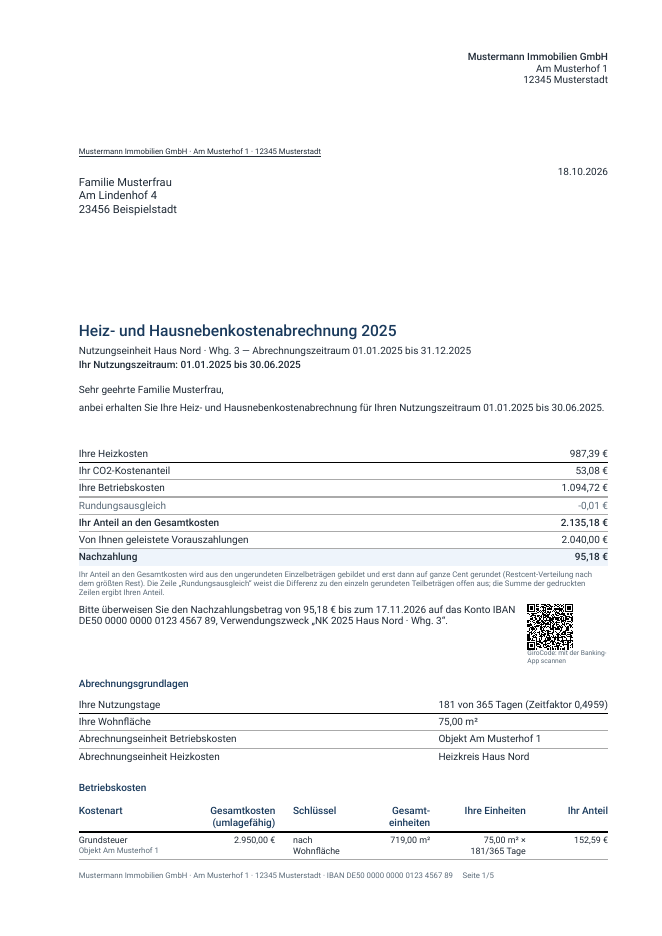

**GiroCode:** Bei einer Nachzahlung steht neben der Zahlungsaufforderung ein
QR-Code nach EPC-Standard. Der Mieter scannt ihn mit der Banking-App;
Empfänger, IBAN, Betrag und Verwendungszweck sind dann ausgefüllt. Ohne
hinterlegten Kontoinhaber druckt die App bewusst keinen Code, weil die Bank
des Mieters den Empfängernamen seit Oktober 2025 mit dem Konto abgleicht.

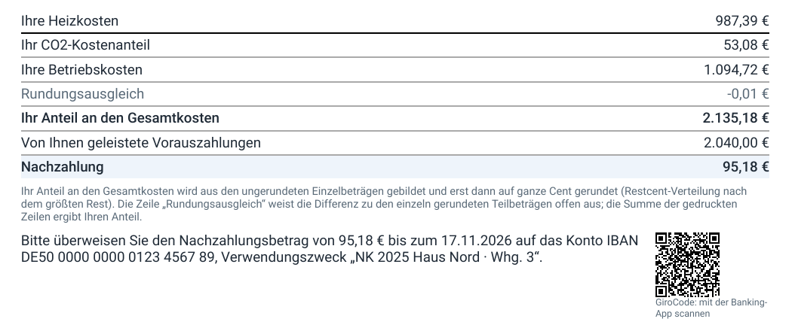

## Rundgang in neun Bildern

### 1. Übersicht

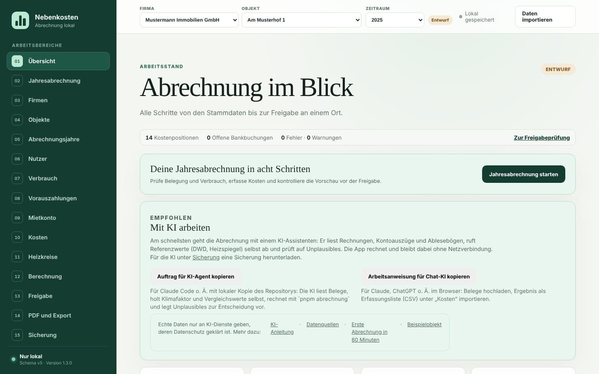

- Oben **Firma, Objekt, Zeitraum** wählen; alle Seiten beziehen sich darauf.
- Die Leiste unter der Überschrift zeigt jederzeit Fehler und Warnungen;
  **Zur Freigabeprüfung** springt zur Liste.
- **Mit KI arbeiten** kopiert einen fertigen Arbeitsauftrag für einen
  KI-Assistenten ([KI-Anleitung](../KI-ANLEITUNG.md)).
- „Lokal gespeichert“ oben rechts bestätigt, dass jede Änderung im Browser
  gesichert ist – eine **Sicherungsdatei** ersetzt das nicht.

### 2. Import prüfen

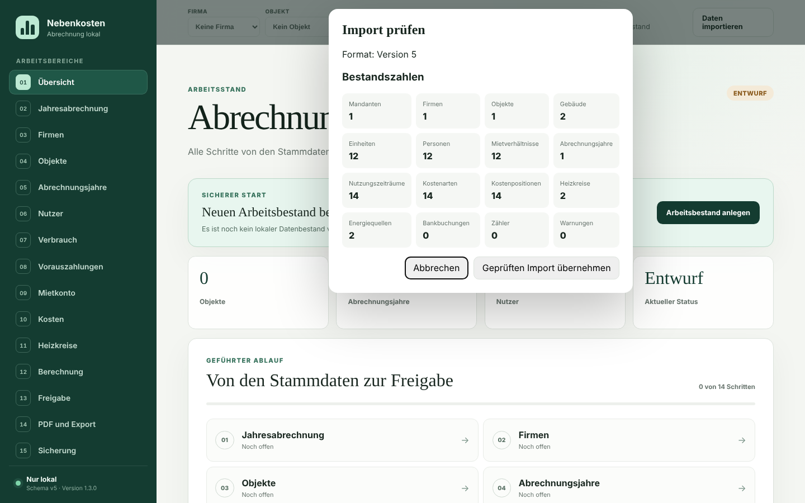

Vor jeder Übernahme zeigt die App, was die Datei enthält. Erst **Geprüften
Import übernehmen** ersetzt den Arbeitsstand; vorher wird ein
Wiederherstellungspunkt angelegt. Unterstützt: Sicherungen dieser App und
`nk-daten.json` der Alt-App. Mieterlisten aus Excel/CSV übernimmt der
Bereich **Nutzer**.

### 3. Jahresabrechnung – Belegung prüfen

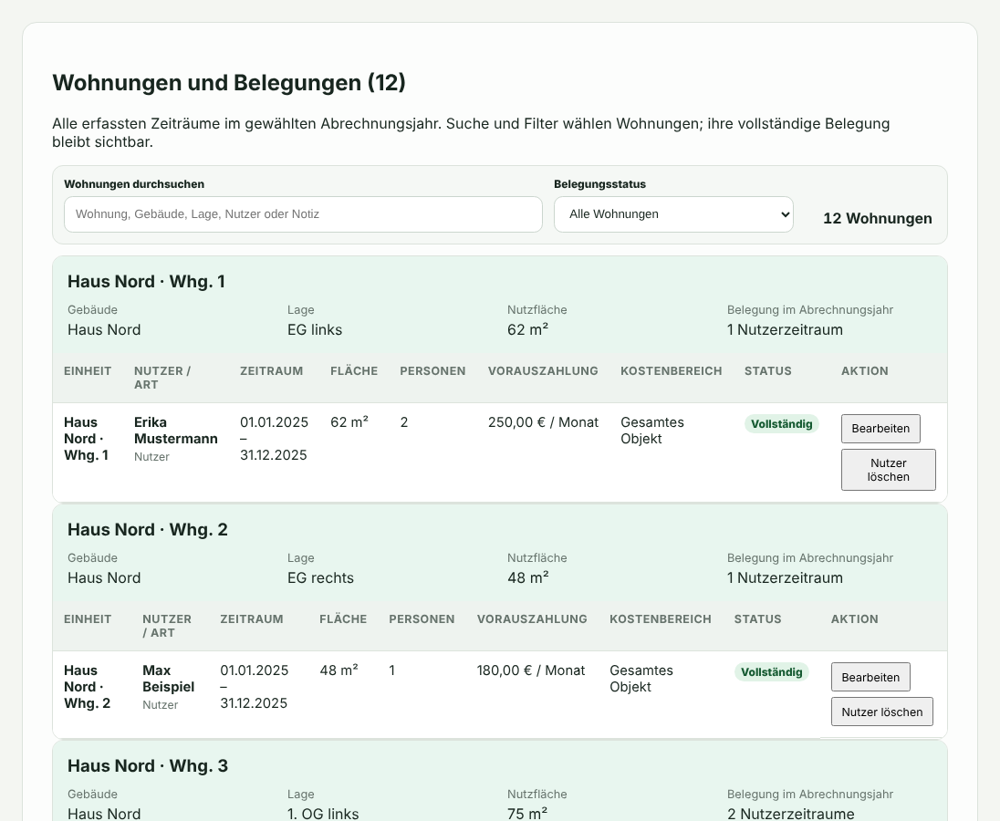

Der Ablauf **Jahresabrechnung** führt durch acht Schritte. Im Schritt
„Belegung und Vorauszahlungen“ steht jede Wohnung mit allen
Nutzungszeiträumen des Jahres; Lücken sind Leerstand und gehen zu Lasten des
Vermieters. „Geprüft – weiter“ markiert den Schritt, „Später prüfen –
weiter“ lässt ihn offen.

### 4. Zählerstände und Verbrauch

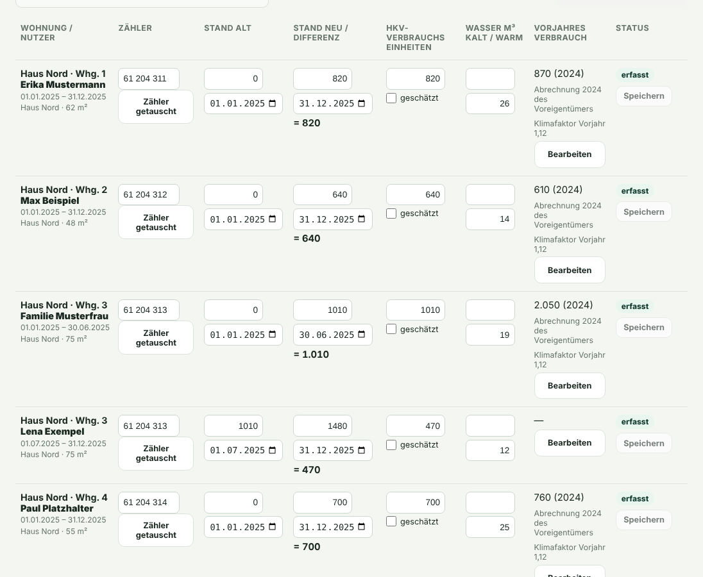

Je Nutzer: Gerätenummer, Stand alt und neu mit Datum, daraus der Verbrauch,
Warmwasser in m³ und der Vorjahresverbrauch mit Quelle. Beim Mieterwechsel
(Whg. 3) endet der Stand des Vormieters am 30.06. und der Nachmieter beginnt
am 01.07. mit demselben Wert – das ist die **Zwischenablesung** nach § 9b
HeizKV. Fehlt ein Wert, schätzt **Schätzen** ihn nach § 9a HeizKV.

### 5. Kosten

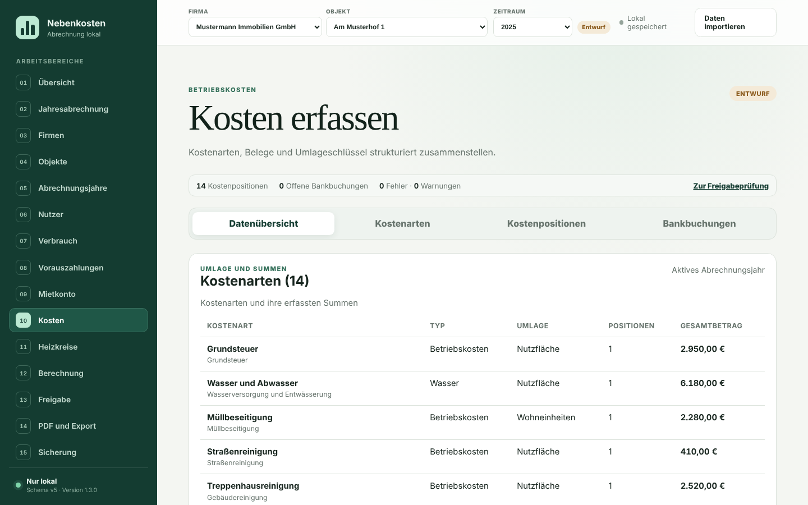

Je Kostenart: Typ, Umlageschlüssel und Summe der Belege. Belege erfassen Sie
unter **Kostenpositionen** einzeln oder als CSV-Liste aus der KI-Erfassung;
Kontoauszüge unter **Bankbuchungen** ([CSV-Formate](../BANK-CSV-FORMAT.md)).
Messdienstkosten als solche kennzeichnen – die Einzelabrechnung nennt sie
nach § 6a Abs. 3 HeizKV gesondert.

### 6. Brennstofflieferungen

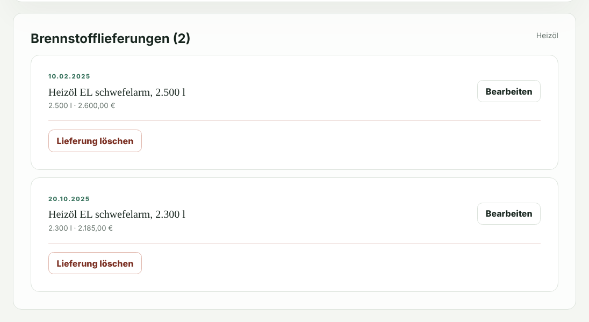

Für Öl, Pellets oder Flüssiggas: Anfangsbestand, jede Lieferung mit Menge,
Betrag, Rechnungsnummer sowie Umsatzsteuer, Energiesteuer und CO₂-Kosten
laut Rechnung, Restbestand am Jahresende. Die App bewertet den Verbrauch nach
FIFO. **Immer die Menge mit erfassen** – ohne Menge sind Warmwasseranteil
und Energiebilanz nicht prüfbar.

### 7. Berechnung

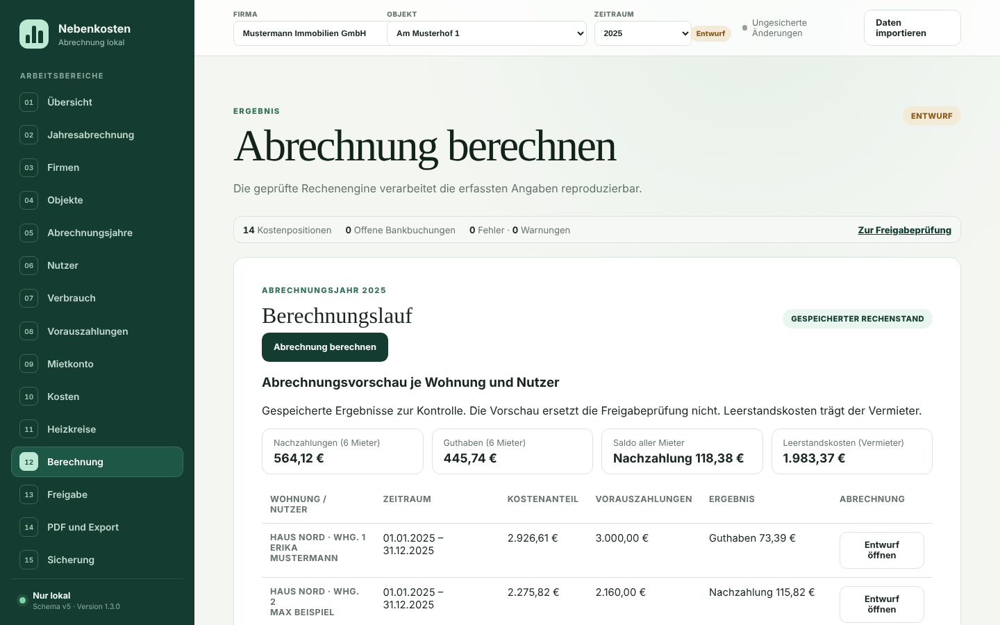

„Abrechnung berechnen“ zeigt Nachzahlungen, Guthaben, Leerstandskosten und
jede Mietpartei mit Kostenanteil und Vorauszahlungen. **Entwurf öffnen**
erzeugt die Einzelabrechnung als PDF zur Kontrolle.

### 8. Prüfung und Freigabe

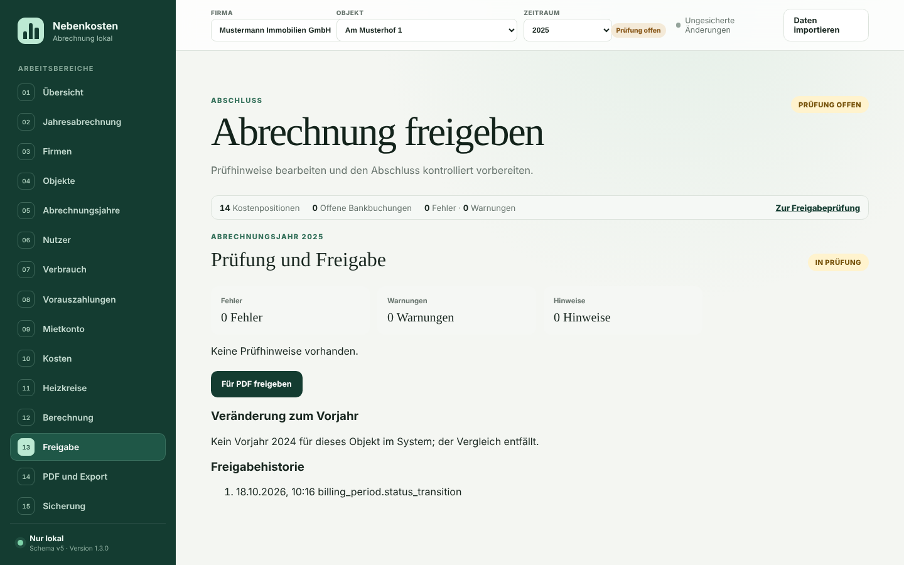

**Prüfung starten** sperrt den Stand; Fehler blockieren die Freigabe,
Warnungen müssen bestätigt oder behoben werden. Jeder Hinweis nennt die
Rechtsgrundlage und führt mit einem Link direkt zur Eingabestelle. Das
Beispiel ist vollständig erfasst: keine Hinweise, **Für PDF freigeben** ist
sofort möglich.

### 9. PDF und Export

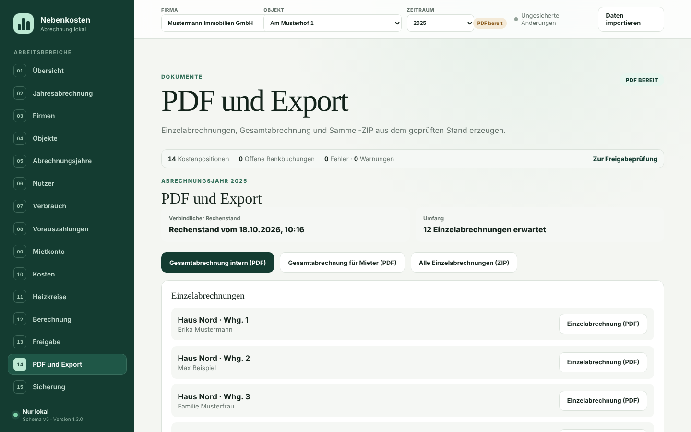

Aus dem freigegebenen Rechenstand entstehen die Einzelabrechnungen (einzeln
oder als ZIP) und die Gesamtabrechnung in zwei Fassungen. Danach unter
**Freigabe** das Versanddatum eintragen und finalisieren; die Frist nach
§ 556 Abs. 3 BGB endet für 2025 am 31.12.2026.

## Bilder und PDFs neu erzeugen

```bash
pnpm install && pnpm build
pnpm medien
```

`pnpm medien` erzeugt alle Dateien dieses Ordners aus dem Beispielobjekt und
schreibt `SHA256SUMS`. Nur Dateien mit passendem Eintrag lässt der
Privacy-Scan zu ([ADR-0012](../DECISIONS/ADR-0012-FREIGEGEBENE-MEDIEN.md)).
**Niemals Screenshots oder PDFs mit echten Daten hier ablegen.**
